# API Shadow

**See every HTTP endpoint in your Express, Fastify, Koa, NestJS and Spring Boot projects without running them, and catch the bugs between them.**

API Shadow reads your source code with real parsers and lists every route it finds in a dedicated sidebar. Each entry shows the HTTP method, the full path with all prefixes applied, the controller and handler, middleware and guards, the services it calls, and the exact source line. Click an endpoint to jump straight to it.

API Shadow also connects the dots across your codebase:

- **Unreachable routes**: `GET /users/me` declared after `GET /users/:id` can never run. API Shadow tells you.
- **Frontend ↔ backend**: Ctrl+click `fetch('/api/users')` in your React or Angular code to jump to the handler. Calls to routes that don't exist are underlined.
- **Callers and tests** for every endpoint, from supertest, NestJS e2e specs and Spring MockMvc.
- **Auth and validation checks**: write and admin endpoints without auth, and request bodies nobody validates.
- **API diff against any branch**, with breaking changes flagged, ready to paste into a pull request.
- **Change impact**: rename `user.name` to `user.fullName` in a handler and API Shadow points at the React component that still reads `user.name`, with a quick fix.
- **OpenAPI contract diffs** between git revisions, classified as breaking, potentially breaking, non-breaking or informational.
- **Security Radar**: hardcoded credentials, permissive CORS, mass assignment, injection, missing auth and more, each with evidence, confidence and a mitigation.
- **Dependency graph** from component to API function, request, route, handler, service and repository.
- **Generated API tests** (Jest, Vitest, Mocha with Supertest; JUnit with MockMvc) as editable starting points.
- **Try it**: a ready-to-send request for any endpoint, plus cURL and `.http` exports.

Everything runs locally. There are no accounts, servers, telemetry or AI services, and your code never leaves your machine.

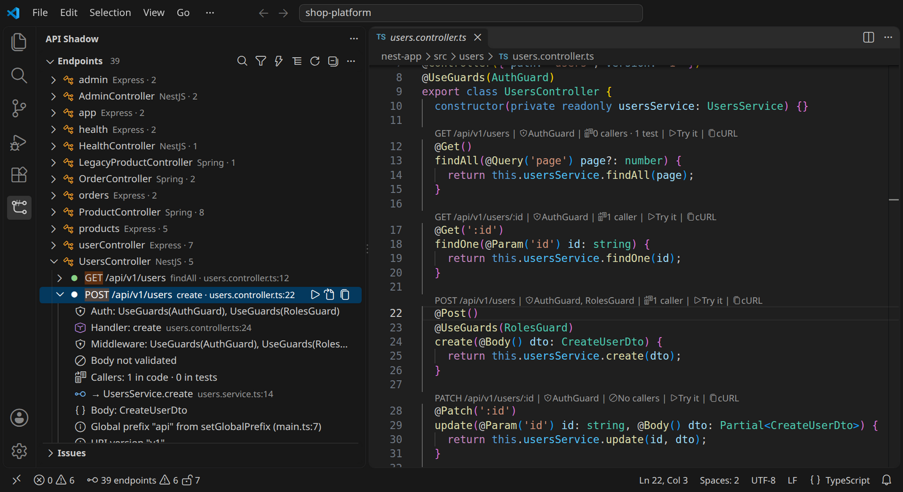

## See it in action

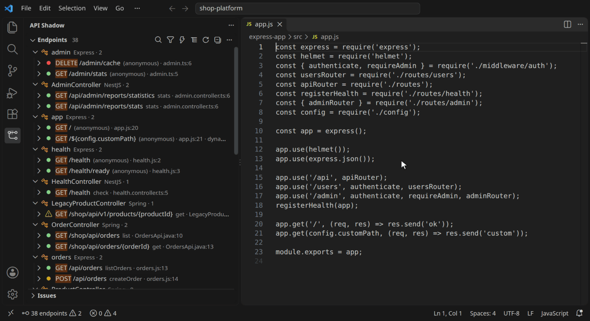

## Getting started

1. Install API Shadow and open a folder that contains an Express, NestJS or Spring Boot project. Monorepos with several projects (or several Maven/Gradle modules) are supported.
2. Click the **API Shadow** icon in the Activity Bar. Analysis starts automatically and usually takes a second or two.
3. Click an endpoint to open its declaration. Expand it to see the handler, middleware, services and how its path was built.

The status bar shows the endpoint count and any potential duplicate routes. Click it to open the sidebar.

## Features

### Dashboard

**API Shadow: Open Dashboard** (or click the status bar item) opens one page with everything API Shadow knows about the workspace:

- **Overview**: endpoint counts by method and framework, matched and unmatched frontend requests, potentially unused routes, potential breaking changes, security findings, and how much of the analysis is certain.
- **API Explorer**: a searchable inventory filtered by method, framework, callers, auth and confidence. Select an endpoint to see its parameters, inferred response, middleware, services, frontend callers (with the fields they read) and tests. A *Frontend requests* view lists every request with its matched route, and *Coverage findings* lists unmatched requests, potentially unused routes, dynamic routes that need a review, duplicate candidates and unreachable routes.
- **Impact Analysis**, **Security**, **Dependency Graph**, **Contracts** and **Test Generator**, described below.

The dashboard follows your theme, works with the keyboard, and only shows data from the analysis of your workspace.

### Change impact: what breaks if this API changes

API Shadow infers what each handler responds with (object literals, local constants, `.map()` over arrays, status codes, thrown NestJS exceptions, declared DTO types, Spring DTOs, records and Jackson annotations). It also follows each frontend request to the fields that are read from its response: through `await`, `.then()`, `res.json()`, axios `data`, supertest `body`, destructuring, React `useState`, react-query `queryFn`, and service functions in other files (`getUser()` in a component, `axios.get()` in `services/user.js`).

When you change a handler, the current code is compared with a baseline (by default **the last commit**, so uncommitted changes are the change) and you see:

```
Potential breaking change since HEAD (3f2a9c1): GET /api/users/:id — Response field `user.name`
renamed to `user.fullName`. `user.name` may have been replaced by `user.fullName`. Risk: HIGH (confirmed).
```

…in the Problems panel at `UserProfile.jsx`, with a quick fix to use `fullName`, and at the endpoint itself, listing every affected read. **API Shadow: Analyze Change Impact** opens the full report: changed paths and methods, removed, renamed and retyped response fields, new required parameters, changed status codes and auth, the callers of each changed endpoint, and the components that receive their data.

- **Confirmed** means a read of the changed field was found. **Heuristic** means callers exist, but how they use the response couldn't be traced.
- **API Shadow: Set Impact Baseline…** compares with a branch or tag instead (e.g. `main`, to review a whole branch) or with the current state.
- Without git, or in an untrusted workspace, the first analysis of the session is the baseline.

The same response shapes also catch mistakes without any change: a component that reads `user.name` from an endpoint that only returns `{ id, fullName }` is flagged where it reads it, with *Did you mean `fullName`?*.

### API contracts (OpenAPI)

**API Shadow: Compare API Contracts (OpenAPI)…** finds OpenAPI 3.x documents (JSON or YAML) and compares:

- the working tree with a branch, tag or commit;
- two git revisions;
- two files;
- a contract with the implementation (documented operations with no route in code, and routes the contract doesn't document).

Every difference is classified as **breaking** (removed operations or response fields, new required inputs, changed types, auth newly required), **potentially breaking** (response fields that may now be missing, changed success status, new enum values in responses), **non-breaking** (additions) or **informational** (auth removed, deprecations, new error statuses). Local `$ref`s and `allOf` are resolved; remote references are reported, never fetched. Without a contract, **Compare API with Branch or Tag…** compares the API inferred from code; it is labelled best effort.

### Security Radar

The **Security** view and dashboard tab list potential API risks found in the code:

| Rule | Looks for |
|---|---|
| `hardcoded-secret` | Provider keys (AWS, GitHub, Stripe, Slack, Google, …), private keys, credentials in connection strings, literal passwords, tokens and JWT or session secrets, in source and Spring configuration |
| `sensitive-response` | Response fields such as `passwordHash`, `ssn` or `cardNumber`, and whole user records sent straight from the database |
| `missing-auth` | Write and admin endpoints with no recognizable auth, in projects where other endpoints have auth (middleware inherited from parent routers counts) |
| `permissive-cors` | `cors()` for all origins, reflected origins with credentials, `Access-Control-Allow-Origin: *`, `@CrossOrigin`, `allowedOrigins("*")` |
| `mass-assignment` | The whole request body written to a model (`User.create(req.body)`), or a Spring `@Entity` bound as `@RequestBody` |
| `object-authorization` | A path id passed to data access on a protected route that never reads the current user or checks ownership |
| `injection` | Request input in SQL strings, shell commands, `eval`, or used as a whole database filter |
| `open-redirect` | Redirects to a location taken from the request |
| `path-traversal` | File paths built from request input |
| `error-details` | Stack traces, exception messages and error objects sent to clients, and Spring settings that include them |
| `config-exposure` | Actuator endpoints such as `env` or `heapdump` exposed by configuration |

Every finding has a rule id, severity, confidence, evidence, an explanation and a recommended mitigation. These are **potential** issues, not confirmed vulnerabilities. Dismiss false positives (they stay dismissed in this workspace), turn rules off with `apiShadow.security.disabledRules`, and exclude files with `apiShadow.security.exclude`. High-severity findings also appear in the Problems panel (`apiShadow.diagnostics.security`).

### Dependency graph

**API Shadow: Show Dependency Graph** draws how requests flow through the code: components → API functions → requests and tests → endpoints → handlers → services → repositories and models. Click a node to highlight everything upstream and downstream of it, double-click (or press **O**) to open its source. Filter by method and framework, focus on matching endpoints, and show only what the current change affects. Unmatched requests (dashed), endpoints without callers (faded), ambiguous matches (dotted edges) and impacted nodes (red outline) are marked. Large APIs show the most connected endpoints first (`apiShadow.graph.maxEndpoints`). Export as Mermaid or JSON.

### Generate API tests

**API Shadow: Generate API Tests…** (also on an endpoint's context menu) writes test files you can edit:

- **Node**: Jest, Vitest or Mocha (detected from `package.json`) with Supertest. The app module is found automatically (`module.exports = app`); NestJS tests bootstrap `AppModule`, Fastify tests wait for `app.ready()`.
- **Spring**: JUnit 5 with `@WebMvcTest` and MockMvc, with `@MockitoBean` (Spring Boot 3.4+) or `@MockBean` fields for the controller's services.

Expectations are only written where the code supports them: a 404 test only if the handler sends 404, response properties from the inferred shape, auth tests only for endpoints with detected auth. Anything else is a `TODO` or a pending test (`it.todo`), so a generated file never passes by accident. The files are previewed first and only written when you confirm; existing files are never overwritten, and tests are never run for you. Missing setup (no runner, no Supertest, an app that isn't exported) is listed before you create them.

### Every endpoint, with its real path

API Shadow follows the code to work out the URL a request actually hits. That includes Express mount prefixes through nested routers across files, NestJS global prefixes, URI versioning and `RouterModule`, and Spring class and method mappings, constants and `server.servlet.context-path`. Path constants imported from other files (`router.get(ROUTES.USERS)`, `` `${API}/orders` ``, enums, `module.exports = { ... }`) are resolved too. Paths that depend on runtime values are marked **dynamic** instead of guessed.

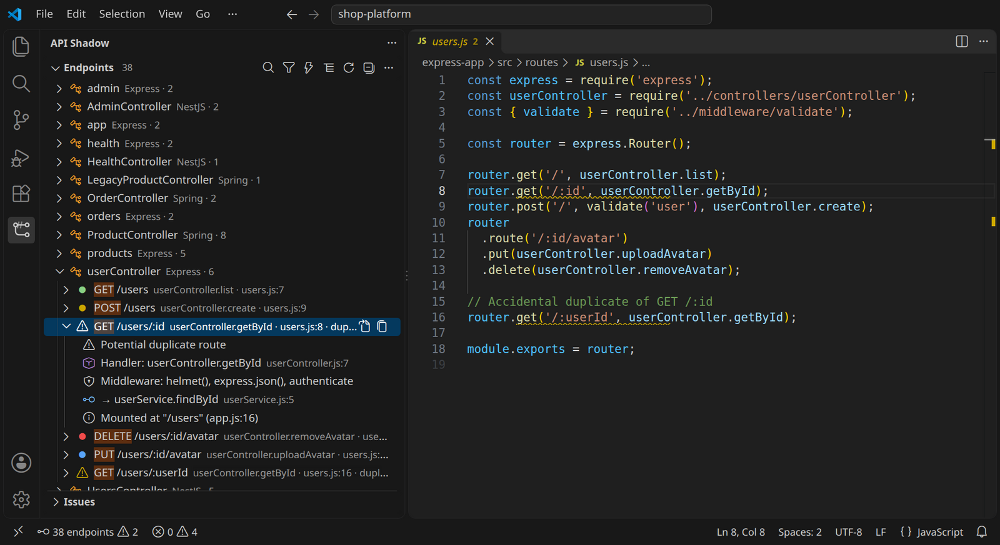

### Catch routes that can never run

Express, Koa and NestJS try routes in the order they're registered and stop at the first match. A parameter route declared too early silently swallows the routes after it:

```js
router.get('/:id', getUser);
router.get('/me', getMe); // never runs: '/me' matches '/:id' first
```

API Shadow finds these: across mounted routers, for catch-all routes (`app.get('*')`) and regex constraints, in the sidebar, the CodeLens and the Problems panel, with a link to the route that catches the requests. Handlers that take `next` are left alone, because they may pass the request on deliberately. Spring and Fastify pick the most specific route, so they aren't affected.

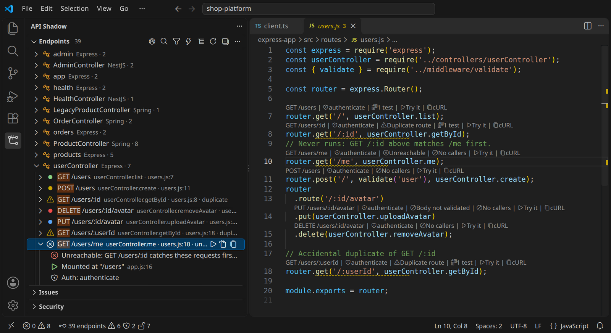

### From the frontend straight to the handler

API Shadow finds HTTP calls in your frontend and test code: `fetch`, axios (including `axios.create({ baseURL })` instances), ky, `$fetch`, Angular `HttpClient`, supertest, and Spring MockMvc, WebTestClient and TestRestTemplate. It matches each call to the endpoint it reaches. It handles template literals (`` `/users/${id}` ``), query strings, absolute `localhost` URLs and base URLs it can't see (`${API_URL}/users`, imported clients).

- **Ctrl+click** the URL to open the handler, and **hover** for its auth, body type and callers.
- A CodeLens above each call names the endpoint it reaches.
- **Calls to missing routes** are underlined: a typo like `/api/order`, or `DELETE` on a route that only has `GET`.
- Each endpoint shows **how many places call it** and **how many tests cover it**; click to see them all. Turn on `apiShadow.clientCalls.reportUncalled` to list endpoints nothing calls.

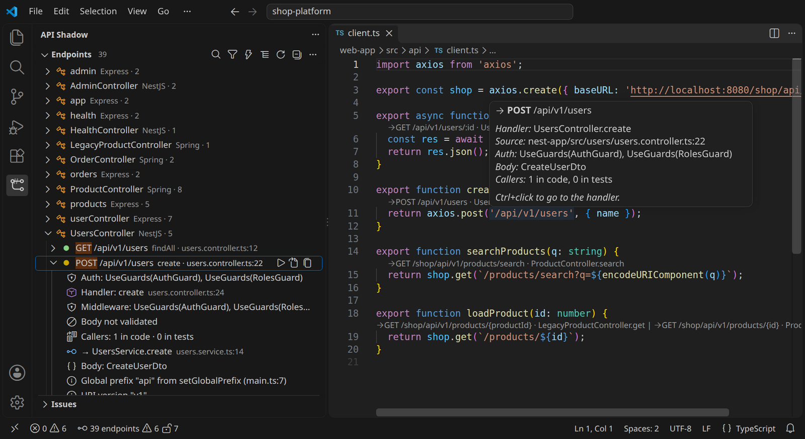

### API diff and breaking changes

**API Shadow: Compare API with Branch or Tag…** analyzes any branch, tag or commit (without checking it out) and compares it with your working tree. You get a report of added, removed and changed endpoints. **Breaking changes** are flagged: removed routes, new required parameters, changed body types and newly required auth. Removed auth is marked 🔓. Paste the report into your pull request.

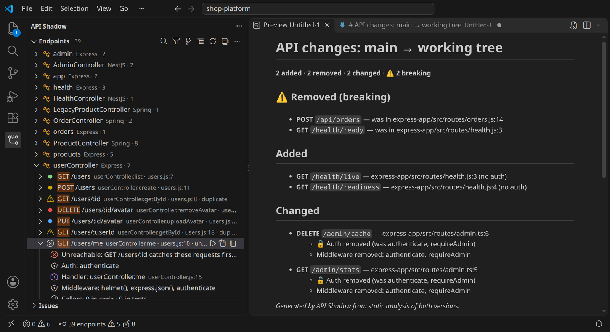

### Request flow

**Show Request Flow** draws the path a request takes: who calls it, how it's mounted, every middleware and guard in order, auth, body validation, the handler and the services it calls. Click any step to open it.

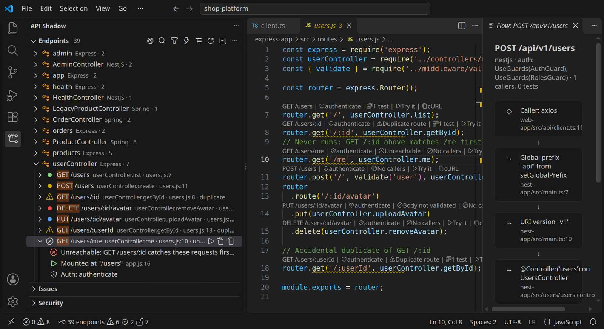

### Right above your code

A CodeLens above every route declaration shows the full method and path (with every prefix applied), the auth that protects it, and duplicate warnings. Click the path for quick actions. Turn it off with `apiShadow.codeLens.enabled`.

### Try any endpoint: cURL and .http requests

Click **Try it** to open a ready-to-send request beside the code, in the `.http` format used by the [REST Client](https://marketplace.visualstudio.com/items?itemName=humao.rest-client) extension and JetBrains IDEs. Click **cURL** to copy the same request as a cURL command.

- Path parameters get sample values (`1`, `example`, or a UUID, based on their type), and required query parameters, headers and cookies are filled in.
- POST, PUT and PATCH requests get a JSON body. Protected endpoints get an `Authorization: Bearer` header, read from `$TOKEN` in cURL.
- The base URL uses the port from `app.listen(3000)` or `server.port`, or set `apiShadow.requests.baseUrl` to target staging.

**Export Endpoints to .http Requests** writes a request for every endpoint into one file, with shared variables at the top, so you get a request collection for the whole API.

API Shadow never sends requests itself. Sending is up to REST Client, cURL or another tool, when you choose.

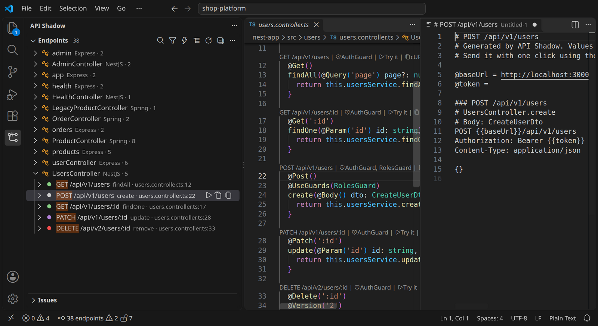

### Find endpoints without auth

API Shadow recognises auth middleware, guards and security annotations: `requireAuth`, `passport.authenticate()`, `expressjwt()`, `@UseGuards(JwtAuthGuard)`, global guards (`APP_GUARD`, `app.useGlobalGuards()`), `@PreAuthorize`, `@Secured` and `@RolesAllowed`. It also recognises explicit opt-outs such as `@Public()` and `@PermitAll`. Every endpoint shows its auth in the sidebar and in its CodeLens.

When a project uses auth, write endpoints (POST, PUT, PATCH, DELETE) and admin or internal paths that have none are flagged in the Issues view, the CodeLens and the status bar. A `POST /orders` with no guard next to protected routes deserves a second look. Sign-in, webhook, health and documentation paths are never flagged. Filter the sidebar with `auth:none` to see every unprotected endpoint.

With a Spring Security filter chain (`SecurityFilterChain`, `@EnableWebSecurity`), endpoints show where security is configured, because per-path rules in it aren't analyzed.

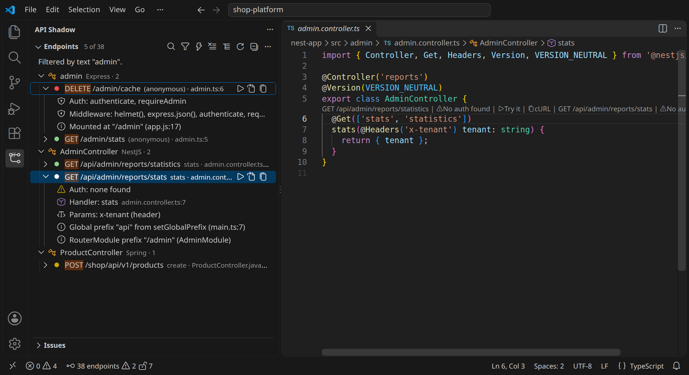

### Handlers, middleware and services

- **Express**: app-level, mount-level, router-level and per-route middleware in the order they run; handlers in controller modules and classes; service calls.
- **NestJS**: `@UseGuards`, `@UseInterceptors`, `@UsePipes` and `@UseFilters`; `@Param`, `@Query`, `@Headers` and `@Body` parameters; services injected through the constructor.
- **Spring Boot**: `@PreAuthorize`, `@Secured` and `@RolesAllowed`; `@PathVariable`, `@RequestParam`, `@RequestHeader` and `@RequestBody`; services in `@Autowired` or constructor-injected fields; mappings inherited from interfaces.

Each linked service and handler opens its declaration with a single click.

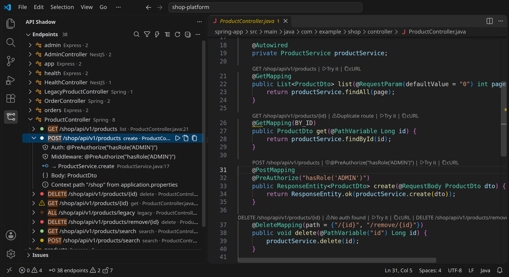

### Search, filter and group

Find any endpoint with **Ctrl+T** (Go to Symbol in Workspace): type `GET /users` or just `users`. **API Shadow: Search Endpoints** works the same way. Narrow the tree by text or by HTTP method. Group it by controller, file, HTTP method, framework or first path segment.

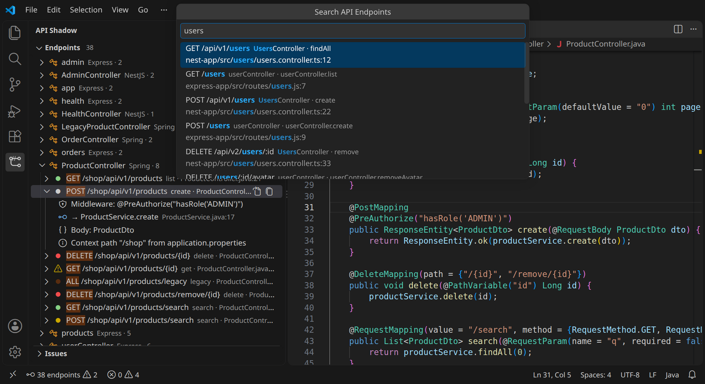

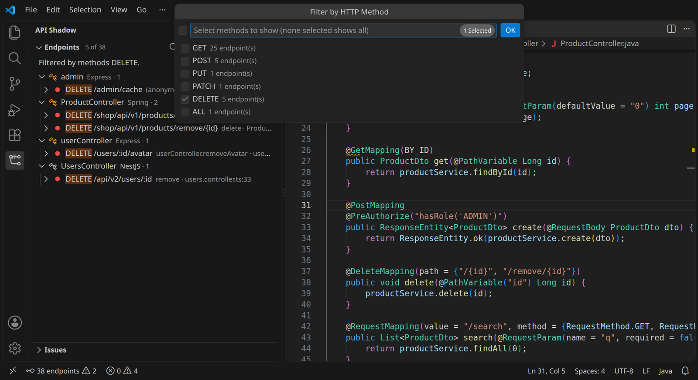

### Request body validation

API Shadow checks whether request bodies are validated. It recognises validation middleware (`validate(schema)`, `celebrate()`, express-validator, zod, joi, yup), schema checks in the handler (`schema.parse(req.body)`), NestJS `ValidationPipe` (global, `@UsePipes` or `@Body(pipe)`), Spring `@Valid` and Fastify route schemas. In projects that validate some bodies, the ones that aren't validated are flagged. So is a NestJS body typed `any`, which a `ValidationPipe` can't check.

### Duplicate routes and analysis issues

API Shadow flags potential duplicate routes: the same method and path within one project, even when parameter names differ (`/users/:id` and `/users/:userId`). Duplicates appear in the sidebar, in the Issues view and in the Problems panel.

The Issues view also lists what could not be analyzed (syntax errors, unresolved modules, unsupported files), each linked to its source line, so you know exactly what the tree does and doesn't cover.

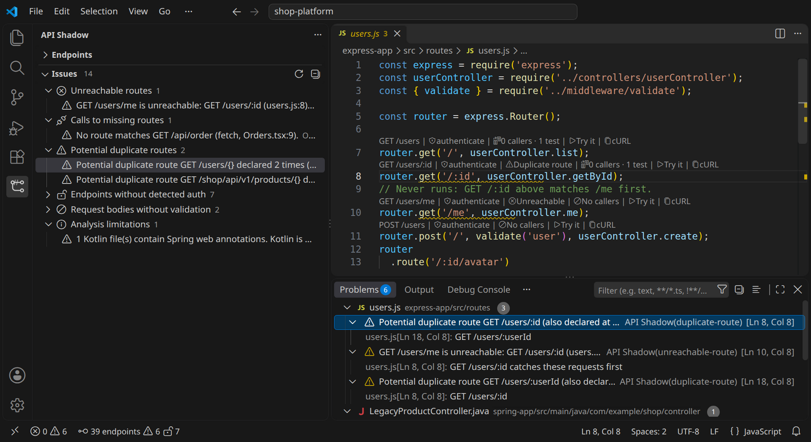

### Export to Markdown, OpenAPI 3.0 and .http

**API Shadow: Export Analysis Report** writes one Markdown report with the overview, change impact, coverage findings, security findings and the endpoint inventory.

Export everything to a Markdown report, to an **OpenAPI 3.0** document, or to a `.http` request collection. The OpenAPI export contains only what was found in code; request and response schemas are never invented. Endpoints OpenAPI can't represent exactly are listed under `x-api-shadow.skipped` with the reason, rather than approximated.

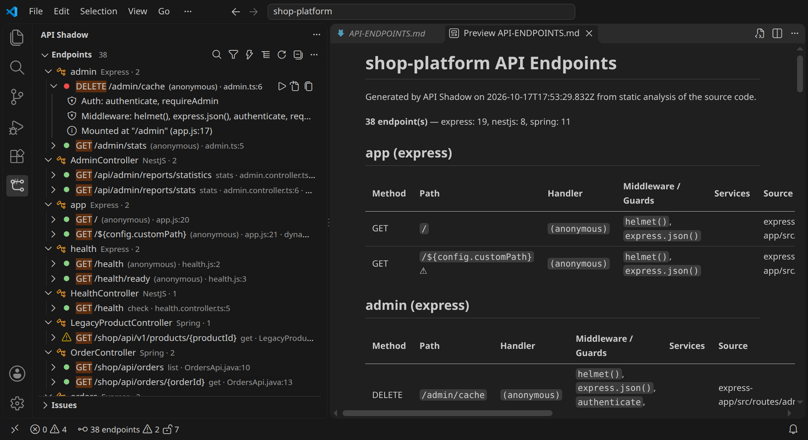

### Stays up to date

When you save a relevant file, API Shadow re-analyzes only what changed, so updates take a fraction of a second even in large repositories. Results are cached between sessions.

## Supported patterns

### Express (JavaScript and TypeScript, CommonJS and ESM)

| Pattern | Example |
|---|---|
| Apps and routers | `express()`, `express.Router()`, `Router()`, `require('express')()`, `new Router()`, inline `Router().use(...)` chains |
| Route methods | `get post put patch delete options head all` (and `del`) |
| Route chains | `router.route('/x').get(h).post(h)`, `router.get('/a', h).post('/b', h)` |
| Path forms | string, template literal, `const` strings and `const` object members, `+` concatenation, arrays of paths, regex literals (shown as `prefix ~ /regex/`) |
| Mounting | `app.use('/api', router)`, `app.use(router)`, `app.use('/a', mw1, mw2, router)`, nested routers across files, multiple mount points |
| Imports | `require`, `import` default/named/namespace, `export { default as x } from`, `export * from`, `module.exports = { a, b }`, `exports.x =` |
| Router factories | `app.use('/x', createRouter(db))` where the function returns a router it created |
| Router parameters | `module.exports = (app) => { app.get(...) }` called as `require('./routes')(app)`; parameters typed `Express`, `Router` or `Application`, or untyped and named `app`, `router`, `api`, `server`, `routes` or `r` |
| Class-based servers | `this.app = express()` or `app = express()` class fields with `this.app.use(...)` |
| Handlers | inline functions, local and imported functions, `controller.method`, `instance.method` (`new Controller()`), `.bind(...)`, single-argument wrappers such as `asyncHandler(fn)` |

### Fastify

| Pattern | Example |
|---|---|
| Apps | `Fastify()`, `fastify()`, `require('fastify')()` |
| Routes | `app.get('/x', handler)`, `app.get('/x', { preHandler, schema }, handler)`, `app.route({ method: ['GET', 'POST'], url, handler })` |
| Plugins | `app.register(plugin, { prefix: '/v1' })` with named, imported, inline and `fastify-plugin`-wrapped plugins, nested to any depth |
| Hooks and schemas | `onRequest`, `preValidation` and `preHandler` hooks shown as middleware; `schema.body` counts as validation |
| Port | `app.listen({ port: 3000 })` |

### Koa

| Pattern | Example |
|---|---|
| Apps and routers | `new Koa()`, `new Router()` from `@koa/router` or `koa-router`, `new Router({ prefix: '/api' })`, `router.prefix('/v1')` |
| Routes | `router.get/post/put/patch/del/delete/all(path, ...middleware, handler)`, named routes `router.get('user', '/users/:id', h)` |
| Mounting | `app.use(router.routes())`, `parent.use('/users', child.routes(), child.allowedMethods())` |

### NestJS

| Pattern | Example |
|---|---|
| Controllers | `@Controller()`, `@Controller('users')`, `@Controller(['a', 'b'])`, `@Controller({ path, version })` |
| Methods | `@Get @Post @Put @Patch @Delete @Options @Head @All` with no path, a string or an array |
| Global prefix | `app.setGlobalPrefix('api', { exclude: ['health', { path, method }] })`, including `(.*)` and `*` wildcards |
| Versioning | `enableVersioning({ type: VersioningType.URI, prefix, defaultVersion })`, `@Version()`, `VERSION_NEUTRAL`. Header and media-type versioning are noted but add no path prefix |
| Modules | `RouterModule.register([{ path, module, children }])` combined with `@Module({ controllers })` |
| Guards and pipes | `@UseGuards`, `@UseInterceptors`, `@UsePipes`, `@UseFilters` on classes and methods; global guards and pipes (`APP_GUARD`, `APP_PIPE`, `useGlobalGuards`, `useGlobalPipes`); `@Body(pipe)` |
| Parameters | `@Param('x')`, `@Query('x')`, `@Headers('x')`, `@Body()` type |
| Services | constructor parameter properties (`constructor(private svc: UsersService)`) and typed fields |

Decorators are recognized only when imported from `@nestjs/*` (aliases are supported), so look-alike decorators never produce false endpoints.

### Spring Boot (Java)

| Pattern | Example |
|---|---|
| Controllers | `@RestController`, `@Controller`, including nested static classes |
| Mappings | `@GetMapping @PostMapping @PutMapping @PatchMapping @DeleteMapping @RequestMapping` with `value` or `path`, arrays, and `method = RequestMethod.X` or `{...}`. `@RequestMapping` without `method` is shown as `ALL` |
| Class level | `@RequestMapping` on the class, both paths and method restriction |
| Constants | `static final String` constants in the same class, other classes (`ApiPaths.V1`), nested classes and interfaces, single and wildcard static imports, `+` concatenation |
| Inheritance | mappings declared on implemented interfaces (OpenAPI Generator `*Api` style) and on abstract base classes |
| Context path | `server.servlet.context-path` and `spring.mvc.servlet.path` from `application.properties` or `application.yml`, per Maven or Gradle module |
| Parameters | `@PathVariable`, `@RequestParam` (`required`, `defaultValue`), `@RequestHeader`, `@CookieValue`, `@RequestBody` type |
| Security | `@PreAuthorize`, `@PostAuthorize`, `@Secured`, `@RolesAllowed`, `@PermitAll`, `@DenyAll` |
| Services | calls on `@Autowired` or constructor-injected fields |

## Known limitations

API Shadow reports what it can prove from the code. When something can't be resolved, it says so in the Issues view instead of guessing.

- **No execution or type checking.** Paths built at runtime (from environment variables, configuration objects or function results) appear as `${expression}`, are marked *dynamic*, and are left out of the OpenAPI export.
- **Express**: routers passed through arbitrary data structures or dependency-injection containers, dynamic `require` paths and routes registered in loops are not followed. Relative imports, `tsconfig.json`/`jsconfig.json` `paths` and `baseUrl` (from the nearest config; `extends` isn't followed) and the `@/` → `src/` convention are resolved; `package.json` `#imports` and bundler-only aliases (Vite, webpack) aren't.
- **NestJS**: middleware configured with `consumer.apply(...).forRoutes(...)` and controllers registered by dynamic modules at runtime aren't shown. One `setGlobalPrefix` per project is used.
- **Spring**: Kotlin controllers are **not supported** (they're reported in the Issues view). Profile-specific configuration (`application-<profile>.yml`), `${...}` placeholders, custom composed mapping annotations, functional routing (`RouterFunction`) and Spring Data REST repositories aren't analyzed.
- **Other frameworks** (Hapi, Micronaut, JAX-RS, …) aren't supported yet.
- **Response shapes** are inferred from literals, local constants and declared types. Values from databases, other functions or generic wrappers are *unknown*, and API Shadow only reports a missing or removed field when the object is fully known (no spreads or unknown parts). TypeScript interfaces are read from the file that declares them; types from packages and complex generics aren't resolved.
- **Response reads** are followed within a function, into functions that return the response (also across files, through relative imports and path aliases), React `useState` and react-query. Data passed to child components as props, stores (Redux, Pinia), Angular services injected with `this.service`, and service modules imported through custom alias prefixes other than `@/`, `~/` and `#/` (e.g. `@app/…`) aren't followed.
- **Security Radar** findings are heuristics from syntax. They don't prove a vulnerability, and they can't prove an endpoint is safe: authorization in custom wrappers, gateways or database policies isn't visible.
- **Impact against git** needs a trusted workspace and analyzes the baseline revision once per commit, which can take a few seconds in large repositories.
- `.gitignore` is applied from the root of each workspace folder only; nested `.gitignore` files and negated patterns aren't.
- Unsaved editor changes are picked up when you save. Files over 512 KB and test files are skipped by default (both configurable).
- Duplicate detection compares method and path with parameter names ignored, within one project. Routes that differ in Spring `params`/`headers`/`consumes`/`produces` conditions or in a NestJS header-selected version are not duplicates. Hosts and Express `router.route()` conditions aren't considered. Parts that can't be resolved statically never make two routes equal unless they are the same expression.
- **Client calls** are matched by URL. Calls whose whole URL is a variable (`fetch(url)`), URLs built by helper functions, and GraphQL or WebSocket traffic aren't linked. Calls through an imported client instance are matched on the path suffix, because the instance's base URL is in another file.
- **Unreachable routes** are found within one router chain in one file at each level. Routes registered from different files on the same router, and NestJS ordering across controllers, aren't compared.
- **API diff** needs a trusted workspace (it runs `git`) and compares the working tree against a commit. **Contract comparison** can also compare two commits.
- **Fastify** `@fastify/autoload` and **Koa** routers created in one file and given a prefix in another aren't followed.
- **Auth detection** matches names of middleware, guards, annotations and decorators (configurable with `apiShadow.auth.patterns`). It shows that an auth check is applied, not that it is correct. Checks inside handlers (`if (!req.user)`), per-path rules in a Spring Security filter chain, and NestJS `consumer.apply()` middleware aren't seen.

## Commands

| Command | Description |
|---|---|
| `API Shadow: Refresh Endpoints` | Re-analyze the workspace |
| `API Shadow: Search Endpoints` | Search all endpoints and jump to the selected one |
| `API Shadow: Filter Endpoints by Text` | Match method, path, controller, handler, file, middleware and services; separate terms with spaces. `auth:none`, `auth:protected`, `auth:public` and `auth:central` match the auth status |
| `API Shadow: Filter by HTTP Method` | Show only the selected methods |
| `API Shadow: Clear Filters` | Remove text and method filters |
| `API Shadow: Group Endpoints By…` | Controller, file, HTTP method, framework, first path segment, or a flat list |
| `API Shadow: Export Endpoints to Markdown` | Write a Markdown report |
| `API Shadow: Export Endpoints to OpenAPI 3.0 (JSON)` | Write an OpenAPI 3.0.3 document |
| `API Shadow: Export Endpoints to .http Requests` | Write a request for every endpoint (REST Client / JetBrains HTTP Client format) |
| `API Shadow: Open as HTTP Request` | Open a ready-to-send request for an endpoint beside the code (same as **Try it**) |
| `API Shadow: Copy as cURL` | Copy a cURL command for an endpoint |
| `API Shadow: Show Request Flow` | Diagram of callers, mounts, middleware, auth, handler and services for an endpoint |
| `API Shadow: Show Callers` | Peek the frontend code and tests that call an endpoint |
| `API Shadow: Compare API with Branch or Tag…` | Report added, removed, changed and breaking endpoints against a git revision |
| `API Shadow: Open Dashboard` | Overview, API explorer, impact, security, graph, contracts and test generation |
| `API Shadow: Analyze Change Impact` | Show what the current changes may break, compared with the impact baseline |
| `API Shadow: Set Impact Baseline…` | Compare with the last commit, a branch or tag, or the current state |
| `API Shadow: Compare API Contracts (OpenAPI)…` | Compare an OpenAPI document across revisions, with another file, or with the implementation |
| `API Shadow: Run Security Analysis` | Re-analyze and show the Security Radar |
| `API Shadow: Show Dependency Graph` | Interactive graph from components to repositories |
| `API Shadow: Generate API Tests…` | Preview and create test files for selected endpoints |
| `API Shadow: Export Analysis Report` | Write the full Markdown report |
| `API Shadow: Export Dependency Graph…` | Write the graph as Mermaid or JSON |
| `API Shadow: Turn Off Security Rule…` | Add a rule to `apiShadow.security.disabledRules` (asks first) |
| `API Shadow: Restore Dismissed Security Findings` | Show dismissed findings again |
| `API Shadow: Clear Analysis Cache and Re-analyze` | Drop cached results and start over |
| `API Shadow: Show Log` | Open the *API Shadow* log (set its level with *Developer: Set Log Level…*) |

Right-click an endpoint for *Go to Handler*, *Open as HTTP Request*, *Show Request Flow*, *Show Callers*, *Generate API Tests…*, *Copy Path*, *Copy Method and Path* and *Copy as cURL*. The ▷ button on an endpoint row opens its request.

## Settings

| Setting | Default | Description |
|---|---|---|
| `apiShadow.frameworks` | all | Frameworks to detect: `express`, `fastify`, `koa`, `nestjs`, `spring` |
| `apiShadow.exclude` | `[]` | Extra glob patterns to exclude |
| `apiShadow.includeTestFiles` | `false` | Show routes declared in test files (`*.spec.*`, `*.test.*`, `__tests__/`, `test/`, `src/test/`) as endpoints |
| `apiShadow.respectFilesExclude` | `true` | Skip files matched by `files.exclude` |
| `apiShadow.maxFiles` | `20000` | Maximum number of candidate files to analyze |
| `apiShadow.maxFileSizeKB` | `512` | Skip larger files (usually generated or bundled code) |
| `apiShadow.autoRefresh` | `true` | Re-analyze when files change |
| `apiShadow.refreshDebounceMs` | `800` | Delay after the last change before re-analyzing |
| `apiShadow.groupBy` | `controller` | Default grouping of the Endpoints view |
| `apiShadow.diagnostics.duplicates` | `true` | Show potential duplicate routes in the Problems panel |
| `apiShadow.showStatusBar` | `true` | Show the endpoint count in the status bar |
| `apiShadow.spring.applyContextPath` | `true` | Prefix Spring endpoints with the configured context path |
| `apiShadow.persistCache` | `true` | Keep analysis results between sessions |
| `apiShadow.export.includeSourceLocations` | `true` | Include file paths and line numbers in exports |
| `apiShadow.codeLens.enabled` | `true` | Show method, path, auth and request actions above each endpoint |
| `apiShadow.requests.baseUrl` | `""` | Base URL for requests and cURL; empty uses `http://localhost:<detected port>` |
| `apiShadow.auth.enabled` | `true` | Detect auth middleware, guards and security annotations |
| `apiShadow.auth.warnings` | `sensitive` | Endpoints without auth to report: `sensitive` (writes and admin paths), `all`, or `off` |
| `apiShadow.auth.patterns` | see settings | Regular expressions for auth middleware, guards and annotations; add your own names here |
| `apiShadow.auth.publicPatterns` | see settings | Regular expressions for explicit opt-outs such as `@Public()` |
| `apiShadow.unreachable.enabled` | `true` | Report routes an earlier route always catches first |
| `apiShadow.diagnostics.unreachable` | `true` | Show unreachable routes in the Problems panel |
| `apiShadow.clientCalls.enabled` | `true` | Link `fetch`/axios/HttpClient/test calls to endpoints |
| `apiShadow.clientCalls.reportUncalled` | `false` | List endpoints nothing in the workspace calls |
| `apiShadow.diagnostics.brokenCalls` | `true` | Underline calls to routes that don't exist |
| `apiShadow.tests.enabled` | `true` | Read test files for endpoint test coverage |
| `apiShadow.validation.enabled` | `true` | Detect request bodies without validation |
| `apiShadow.respectGitignore` | `true` | Skip files matched by the root `.gitignore` of each workspace folder |
| `apiShadow.responseChecks.enabled` | `true` | Report client reads of response fields an endpoint doesn't return |
| `apiShadow.diagnostics.responseMismatch` | `true` | Show those reads in the Problems panel |
| `apiShadow.impact.enabled` | `true` | Analyze the impact of API changes on client code |
| `apiShadow.impact.baseline` | `gitHead` | Compare with the last commit (`gitHead`) or with the first analysis of the session (`session`) |
| `apiShadow.diagnostics.impact` | `true` | Show potential breaking changes in the Problems panel |
| `apiShadow.security.enabled` | `true` | Run the Security Radar |
| `apiShadow.security.disabledRules` | `[]` | Security rules to skip |
| `apiShadow.security.exclude` | `[]` | Glob patterns of files that get no security findings |
| `apiShadow.diagnostics.security` | `high` | Lowest severity shown in the Problems panel: `high`, `medium`, `low` or `off` |
| `apiShadow.contracts.files` | `[]` | Extra glob patterns for OpenAPI documents |
| `apiShadow.graph.maxEndpoints` | `150` | Maximum endpoints drawn in the dependency graph |
| `apiShadow.testGeneration.directory` | `""` | Folder for generated tests, relative to the project root |

`node_modules`, `.git`, `dist`, `out`, `build`, `target`, `coverage`, `.next`, `.gradle` and similar folders are always excluded.

## Privacy and security

- **Your code is never executed.** Files are only read and parsed. Nothing is required, compiled or evaluated, endpoints are never called, and generated tests are never run, so API Shadow also works in Restricted Mode. The exceptions are comparisons with git revisions (**Compare API with Branch or Tag…**, contract comparison and the git impact baseline), which run `git` (`rev-parse`, `ls-tree`, `cat-file`, `for-each-ref`, none of which run hooks) and are only available in trusted workspaces.
- **Nothing leaves your machine.** API Shadow makes no network requests and has no telemetry or AI services. **Try it** and **Copy as cURL** only produce text. Requests are sent only when you send them yourself, with REST Client or cURL.
- **Secrets stay put.** `.env` files are never read. From Spring configuration files, only the context-path, `server.port` and error/actuator exposure settings are kept; every other value is discarded immediately and never logged, cached or exported. When the Security Radar finds a credential, it keeps only the variable name, a known provider prefix (such as `sk_live_`) and the length; no character of the secret itself is stored, cached or shown. Middleware labels never include call arguments, so a call such as `basicAuth({ users: { admin: '…' } })` appears as `basicAuth()`.
- **Nothing is written without you.** Generated tests are previewed and written only after you confirm, never over an existing file, and only inside the workspace. Quick fixes are applied only when you choose them. Turning off a security rule asks before changing workspace settings. Dismissed findings are stored in VS Code's workspace state.
- **The dashboard is sandboxed.** It runs with a strict Content Security Policy (no remote content, only the extension's own script), shows every value as text, and can only ask the extension to open source locations the extension gave it or run a fixed list of API Shadow commands.
- The cache holds only structural facts (routes, names, line numbers), stores them in VS Code's workspace storage, and can be cleared at any time.

## Troubleshooting

- **No endpoints are found.** Check the **Issues** view for parse errors and skipped files, and **API Shadow: Show Log**. Folders in `apiShadow.exclude`, `files.exclude` or the root `.gitignore` are skipped (see `apiShadow.respectGitignore`).
- **Impact analysis says "session start".** The workspace isn't a git repository, has no commits, or isn't trusted. Trust the workspace, or choose a baseline with **Set Impact Baseline…**.
- **A change isn't reported.** Impact is computed when files are saved. Response fields are only compared when the handler builds the response from literals or a declared type; if it returns a database row or a service result, the shape is unknown.
- **A security finding is a false positive.** Dismiss it from the Security view or the quick fix menu, exclude the files with `apiShadow.security.exclude`, or turn the rule off. If your auth middleware isn't recognized, add its name to `apiShadow.auth.patterns`.
- **Generated tests can't import the app.** Export the app from its module (`module.exports = app` / `export default app`) without calling `listen()` on import, so tests can start it themselves.
- **The graph is crowded.** Type a path or controller in *Focus on endpoints matching…*, filter by method, or turn on *Impacted only*.
- **Stale results.** Run **API Shadow: Clear Analysis Cache and Re-analyze**.

## Contributing

Bug reports and pull requests are welcome. See [CONTRIBUTING.md](CONTRIBUTING.md) for building, testing and packaging, and [docs/ARCHITECTURE.md](docs/ARCHITECTURE.md) for how the analysis works.

## License

[MIT](LICENSE)
